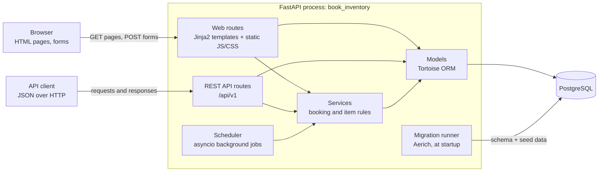
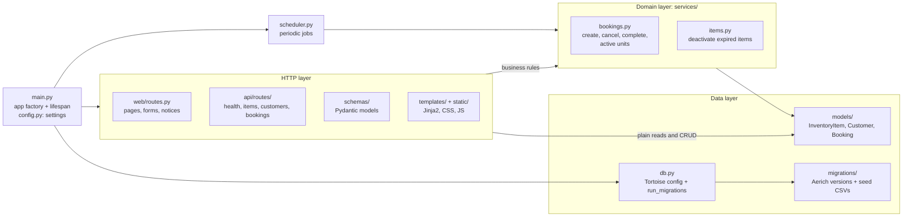
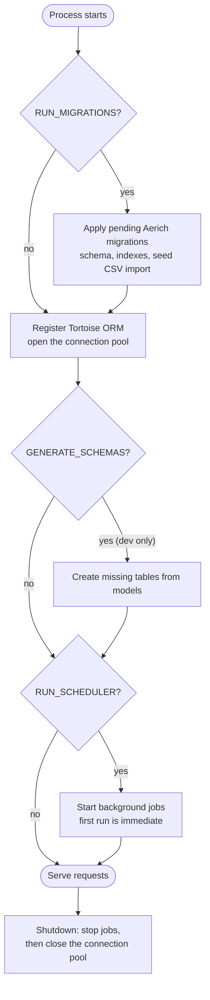
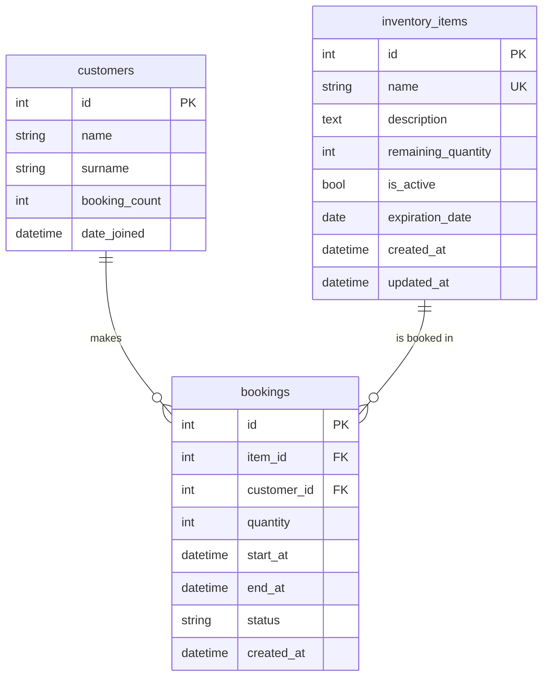
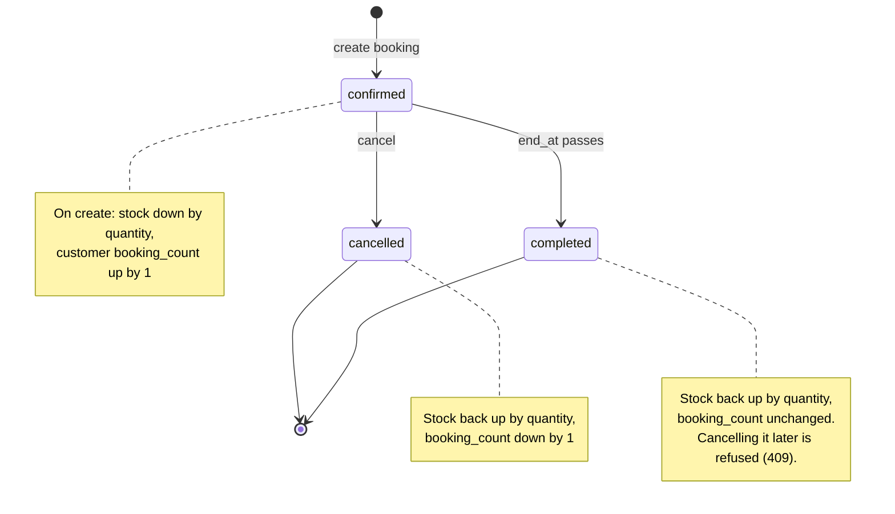
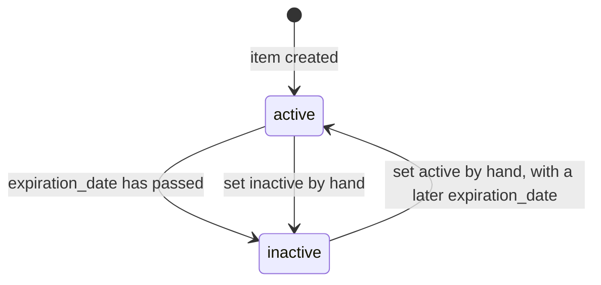
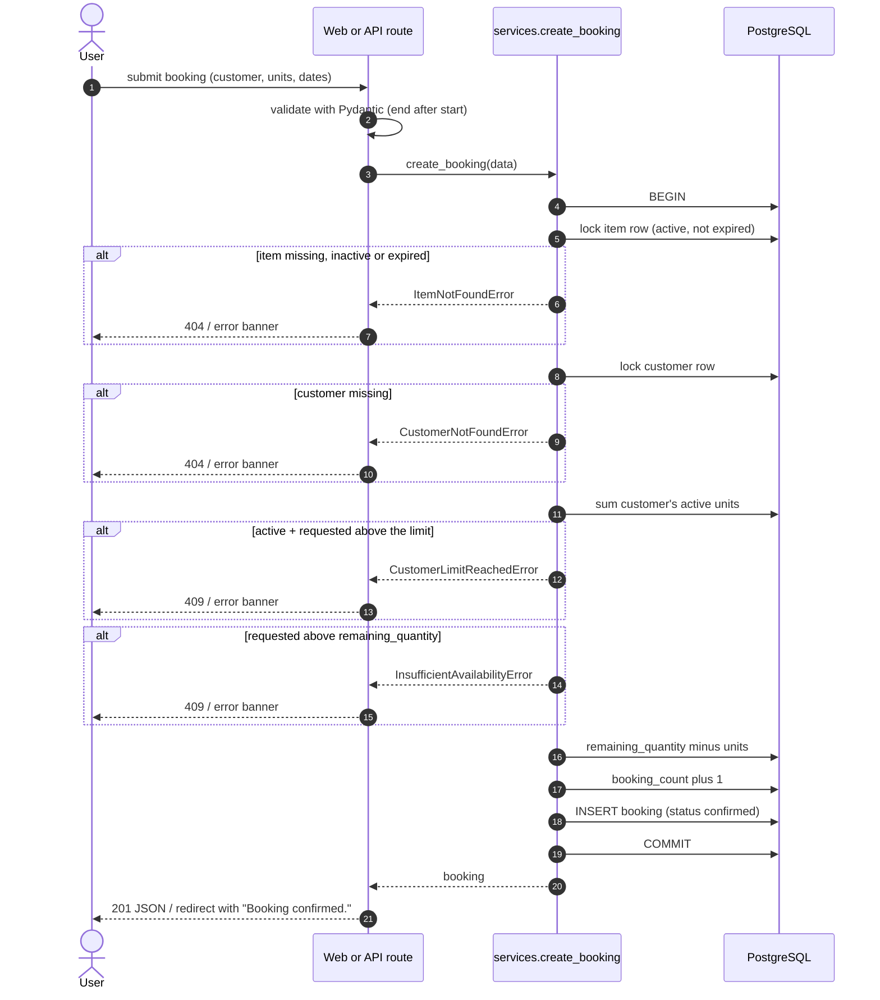
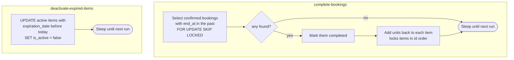
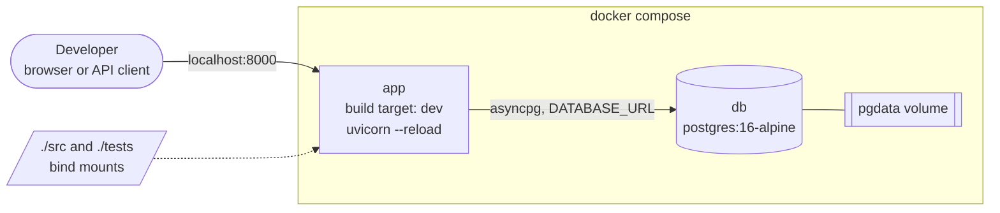

# Architecture

How `book-inventory` is put together: what runs where, how a request flows through the code, the
data model, and the rules that keep stock and booking counts correct. For setup, the API table and
configuration, see the [README](README.md).

Contents: [System overview](#system-overview) · [Code layers](#code-layers) ·
[Startup and shutdown](#startup-and-shutdown) · [Data model](#data-model) ·
[Booking lifecycle](#booking-lifecycle) · [Creating a booking](#creating-a-booking) ·
[Background jobs](#background-jobs) · [Concurrency](#concurrency) ·
[Indexes and performance](#indexes-and-performance) · [Deployment](#deployment) ·
[Design decisions](#design-decisions)

## System overview

One FastAPI process serves both the JSON API and the server-rendered web UI. There is no separate
frontend build. The process also runs the background jobs and applies database migrations when it
starts. PostgreSQL is the only external dependency.



## Code layers

Routes stay thin. They parse input, call a service or the models, and shape the response. The rules
that matter (stock, limits, expiry) live in `services/` so the API and the web UI cannot disagree.



| Layer | Responsibility |
| --- | --- |
| `web/` | HTML pages and form handling. Reads fixed `?notice=` codes to show confirmation messages, never free text from the URL. |
| `api/` | JSON endpoints under `/api/v1`, with the status codes listed in the README. |
| `services/` | Business rules and transactions. Every change to stock, booking counts or booking status that results from a booking goes through here. (Items and their `remaining_quantity` can also be edited directly through the items API.) |
| `models/` | Tortoise models, table names and indexes. |
| `scheduler.py` | Runs the periodic jobs; contains no business logic of its own. |
| `migrations/` | Versioned schema changes (Aerich) and the seed data import. |

## Startup and shutdown

The app's lifespan runs these steps in order, and tears them down in reverse. Each optional step is
controlled by a setting.



## Data model

Three tables. Bookings link a customer to an item, and both foreign keys use `ON DELETE RESTRICT`,
so an item or customer that has bookings cannot be deleted.



What the less obvious columns mean:

- `inventory_items.remaining_quantity` is a running counter of units still available. Confirming a
  booking subtracts from it, and cancelling or completing a booking adds back. Booking dates do not
  affect it.
- `inventory_items.expiration_date` is the last day an item can be booked. After that the item is
  deactivated.
- `customers.booking_count` counts bookings that were made and not cancelled. It does not drop when
  a booking completes. The seed data gives customers starting values with no booking rows behind
  them, so use the bookings table (not this column) for anything that must be exact.
- `bookings.status` is `confirmed`, `cancelled` or `completed`.

Indexes are chosen per query; see [Indexes and performance](#indexes-and-performance).

## Booking lifecycle

A booking is created `confirmed` and ends as either `cancelled` or `completed`. Both end states are
final, and each transition updates stock and counts inside one transaction.



Items have their own small lifecycle, driven by `expiration_date`:



## Creating a booking

The same service call backs both `POST /api/v1/bookings` and the web form. Everything between
`BEGIN` and `COMMIT` is one transaction, so a rejected booking changes nothing.



Cancelling mirrors this: lock the booking, return `409` if it already completed, otherwise mark it
cancelled, give the units back and lower the customer's count. Cancelling twice is harmless, and the
units are returned only once.

## Background jobs

`scheduler.py` runs two asyncio tasks inside the app process. Each runs once at startup, which
catches up after downtime, and then every `COMPLETE_BOOKINGS_INTERVAL_SECONDS`. A failed run is
logged and retried on the next tick; it never stops the loop.



Booking an item that has just expired is refused even before the second job has run, because
`create_booking` also checks `expiration_date` itself.

## Concurrency

The app is safe to run as several workers or instances, because correctness is enforced in the
database rather than in process memory:

| Risk | How it is handled |
| --- | --- |
| Two bookings for the last unit | The item row is locked (`SELECT ... FOR UPDATE`), so bookings for one item run one at a time. |
| Two bookings pushing one customer past the limit | The customer row is locked as well, so the limit check and the insert cannot interleave. |
| Two cancels of the same booking | The booking row is locked and its status re-read, so units come back once. |
| Two scheduler runs completing the same booking | `SKIP LOCKED` makes a second run skip rows the first holds. |
| Deadlocks | Locks are taken in a fixed order: booking, then item, then customer. The scheduler locks bookings first, then items by ascending id. |

A customer's `booking_count` is changed with a SQL expression (`booking_count = booking_count + 1`). An
item's `remaining_quantity` is read, changed and saved in Python, which is safe because the item row is
locked for the whole transaction.

## Indexes and performance

### Indexes

Every index exists for a specific query; check any new one with `EXPLAIN ANALYZE` before adding it.

| Table | Index | Serves |
| --- | --- | --- |
| all | primary keys | lookups by id |
| `inventory_items` | unique `name` | duplicate-name check, name lookups |
| `bookings` | `(item_id, start_at)` | an item's bookings newest-first (item page, `GET /bookings?item_id=`), the delete-item guard, and the `item_id` foreign key |
| `bookings` | `(customer_id)` where `status = 'confirmed'` | a customer's active units (booking limit, customer dropdown) |
| `bookings` | `(end_at)` where `status = 'confirmed'` | the scheduler's "confirmed bookings that have ended" lookup, every minute |

The two `confirmed` indexes are partial: bookings pile up as `completed`/`cancelled` history, but only
the few confirmed ones are ever looked up this way, so the indexes stay tiny. (Measured on 300,000
bookings: each is about 40 kB, and those lookups dropped from ~20 ms full-table scans to ~0.06 ms.)

`customers` has no secondary index and `inventory_items` has none besides `name`: both stay small and
are read whole, so Postgres would scan them rather than use an index. Revisit if that changes.

Not indexed on purpose: `bookings.start_at` and `end_at` on their own. They were indexed for a
time-window overlap query that no longer exists, and nothing uses them.

List the indexes in a running database:

```sql
SELECT tablename, indexname, indexdef FROM pg_indexes WHERE schemaname = 'public' ORDER BY 1, 2;
```

### Performance notes

- The item page shows the latest 100 bookings (a note appears when older ones are left out); bookings
  only ever accumulate, so an unbounded list would grow forever.
- Per-customer active units are summed by the database (one query for the limit check, one grouped
  query for the whole dropdown) rather than loaded into Python or joined across all booking history.
- The Postgres connection pool defaults to 5 connections. Raise it through the URL when serving more
  concurrent requests, e.g. `DATABASE_URL=postgres://…/book_inventory?maxsize=20`.
- `GET /api/v1/items`, `/customers` and `/bookings` return every row (no pagination yet), which is fine
  at this size.

## Deployment

Docker Compose runs two containers. In development the source is bind-mounted and uvicorn reloads on
change. The migration step means a fresh database needs no manual setup.



- The `app` service waits for the database health check before starting.
- A `prod` image target exists: a regular install with no dev dependencies and no reload.
- The CSVs and migrations live inside the package (`src/book_inventory/migrations/`) so they ship in
  the image.

## Design decisions

| Decision | Why |
| --- | --- |
| One process for API, UI and jobs | The project is small; there is no queue or second service to operate. Row locks make this safe if it is scaled out later. |
| Server-rendered pages instead of a SPA | No build step, and the UI needs only forms and tables. |
| Business rules in `services/` | The API and the web UI share one code path, so stock and limits behave identically. |
| `remaining_quantity` is a counter | It is what the UI shows and what stock checks read, so there is no per-request time-window calculation. The cost: units come back only on cancel or completion. |
| `completed` is its own status | The job can tell finished bookings from cancelled ones, and a finished booking cannot give its units back twice. |
| Active units for the limit come from the bookings table | `booking_count` includes completed bookings and seed values, so it is not exact. |
| Migrations (Aerich), not `generate_schemas` | Schema changes are versioned and reversible. `GENERATE_SCHEMAS` is off by default. |
| Partial indexes on confirmed bookings | Only a few bookings are confirmed at any time, so the indexes stay small as history grows. |
| Fixed notice codes in redirects | `?notice=booked` selects a message from a list, so the page never echoes text from the URL. |

Known limits, kept simple on purpose:

- No authentication or authorisation; anyone who can reach the app can use it.
- The list endpoints return every row, with no pagination. The item page shows the latest 100
  bookings.
- Jobs run in-process. If the app is down, nothing runs; the first run after startup catches up.
